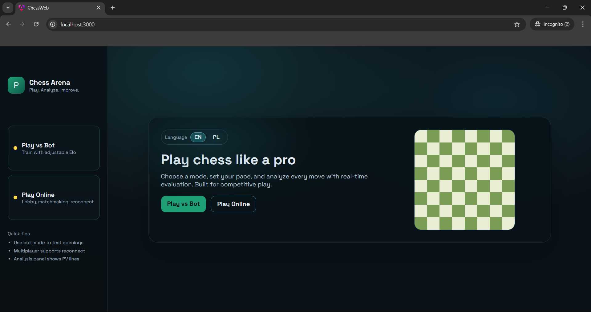
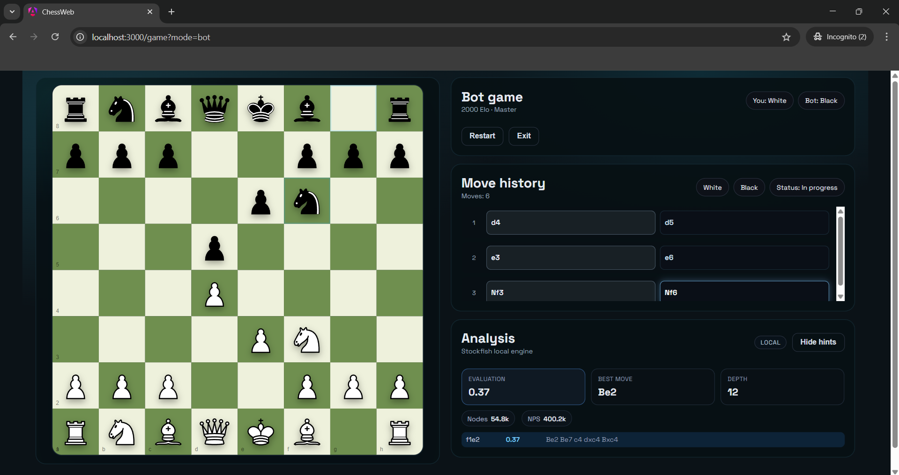
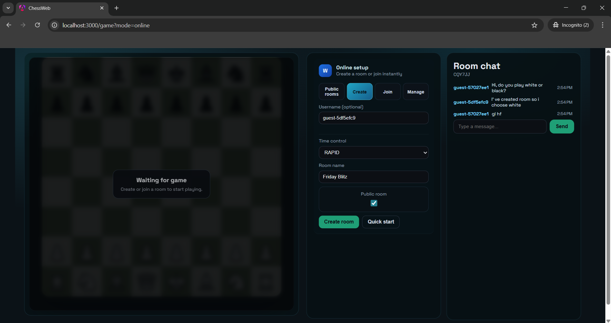
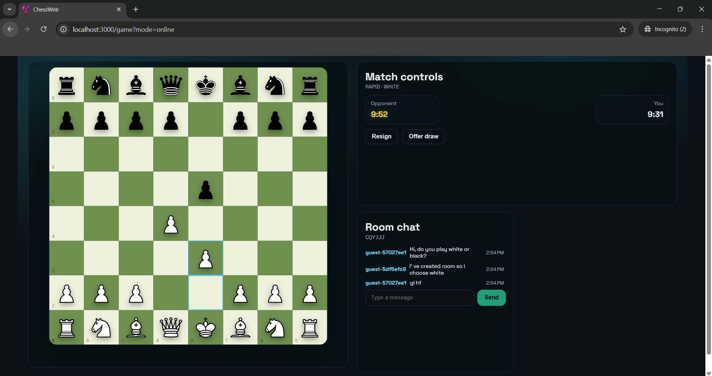

# ♟️ Real‑Time Chess (Angular + Spring Boot)

A real-time chess application designed for **commercial-grade development.** Games are fully persisted in **PostgreSQL**, supporting reconnect and full state sync.

This is structured like a real product.
This is not include multiplayer points ranking.

---

## ✅ Tech Stack

- **Frontend:** Angular (TypeScript)  
- **Backend:** Java 21 + Spring Boot 3  
- **Database:** PostgreSQL
- **Multiplayer:** WebSocket (STOMP + SockJS)  
- **Chess Engine:** Stockfish WASM running in a **WebWorker**  
- **Deployment:** Docker + Docker Compose (**one command starts everything**)  

---

## 📸 Screens






---


---
## 🎯 Product Goals

The app supports:

- Playing **local chess**, **vs BOT**, or **ONLINE multiplayer**
- Realistic BOT levels: **Elo 200–2000** (step 200)
-  **Analysis panel**:
  - evaluation bar
  - evaluation score (`+1.3`, `-0.7`, `M#3`)
  - top moves + PV lines
- Ability to hide hints
- Full persistence of games & moves in PostgreSQL
- Lobby + invite code
- Matchmaking queue
- Reconnect & state sync (DB-driven)
- Server-authoritative rules validation in multiplayer
- No lag (engine in worker)
- Fully FIDE-compliant chess rules

---

## 🚀 Run (Docker — recommended)


```bash
docker compose up --build
```

After startup:
- Frontend (nginx): `http://localhost:3000`
- Backend: `http://localhost:8080`
- WebSocket endpoint: `http://localhost:8080/ws`

> If your repo uses different ports, check `docker-compose.yml` and `application.yml`.

### Stop

```bash
docker compose down
```

### Reset DB (⚠️ deletes all data)

```bash
docker compose down -v
docker compose up --build
```

---

### 🧱 Frontend (Angular dev settings)

```bash
cd frontend
npm ci
npm run start
```

Angular dev proxy should forward API + WebSocket to backend (repo-dependent config).

---
## ♟️ BOT + Stockfish WASM (WebWorker) — realistic Elo scaling

### Key principles

- The BOT uses **Stockfish WASM** inside a **WebWorker**.
- BOT strength is derived from:
  - analysis time budget
  - max depth cap
  - randomness among top candidate moves
  - controlled blunders for low Elo levels

---

## 📊 Mandatory Elo → Engine Behavior Mapping

This mapping must exist in code (can be tuned slightly, logic must remain identical):

| Elo  | Analysis time | Depth cap | Move selection | Behavior |
|-----:|--------------:|----------:|----------------|----------|
| 200  | 20–40 ms      | max 1     | random legal move | chaotic, hangs pieces |
| 400  | 50 ms         | max 2     | random from top 8 | frequent blunders |
| 600  | 80 ms         | max 3     | random from top 6 | misses tactics |
| 800  | 120 ms        | max 4     | random from top 5 | overlooks threats |
| 1000 | 180 ms        | max 6     | random from top 4 | basic strategy |
| 1200 | 250 ms        | max 8     | random from top 3 | rare blunders |
| 1400 | 350 ms        | max 10    | top 2            | solid play |
| 1600 | 500 ms        | max 12    | best / top 2     | strong tactics |
| 1800 | 800 ms        | max 15    | best move        | very strong |
| 2000 | 1200 ms       | max 18    | best move        | near flawless |

### Additional mandatory rules

- Low Elo must sometimes:
  - intentionally hang a piece,
  - miss mate-in-1,
  - play a move that worsens evaluation.
- High Elo:
  - almost always chooses best move,
  - avoids repetitions and cheap draws when winning.
- The BOT must not play meaningless nonsense loops (queen shuffling every move).

---

## 🧠 Analysis Panel (Chess.com-like)

Features:
- evaluation bar (white ↔ black)
- evaluation value (`+1.3`, `-0.7`, `M#3`)
- top 3–5 moves:
  - SAN / UCI
  - evaluation
  - PV line
- highlight best move

Toggle: **Hide hints**
- hides PV lines + move list
- eval bar is hidden or blurred (UI consistent)

Performance:
- analysis runs in WebWorker
- throttling enabled
- cancelled on every new move

---

## ♟️ FIDE Rules Support Checklist

Supported:
- legal moves
- castling (full rules)
- en passant
- pawn promotion (UI selection)
- check / checkmate / stalemate
- draws:
  - threefold repetition detection + UI feedback
  - 50-move rule detection + UI feedback

Multiplayer:
- backend validates legality and game outcome.

---

## 🧪 Testing

### Backend

- chess move validation (castling, en passant, promotion)
- `GameService` tests (flow, persistence, game end conditions)
- WebSocket flow tests:
  - happy path
  - illegal move rejection
  - reconnect + sync

Run:
```bash
./gradlew test
```

### Frontend

- unit tests for WS + state store
- board component tests (promotion dialog, turn enforcement)

---

## 👤 Maintainer

**Milosz Podsiadly**  
📧 [m.podsiadly99@gmail.com](mailto:m.podsiadly99@gmail.com)  
🔗 [GitHub – MiloszPodsiadly](https://github.com/MiloszPodsiadly)

---

## 🪪 License

Licensed under the [MIT License](https://opensource.org/licenses/MIT).